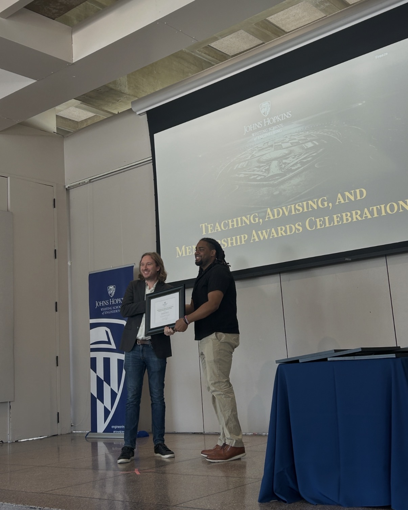

I am a 4th year PhD candidate in `Chemical and Biomolecular Engineering` and Master's student in  `Applied Mathematics and Statistics` at `Johns Hopkins University`. I am currently in Dr. [Jeffrey J. Gray's lab](https://graylab.jhu.edu), developing antibody-specific language models.

For 

**Things I enjoy outside of research** 
  - **Teaching/Mentoring**: Docendo Discimus ~ "By teaching, we learn". I am a strong advocate for [Bloom's Taxonomy](https://ies.ed.gov/ncee/rel/regions/northeast/onlinetraining/ResourcesTools/Bloom's%20Taxonomy.pdf) and I enjoying seeing others get to the top of this pyramid. The best way to truly grasp a concept is to wrestle with it until it becomes second nature. "The accumulation of facts followed by the slow assimilation of understanding cannot be achieved without struggle" ~ 

  

  - **Playing Basketball**: I'm a regular visitor of the local rec.

  

  - **Watching Anime**: I am currently watching...

  

  - I have finished: ...
