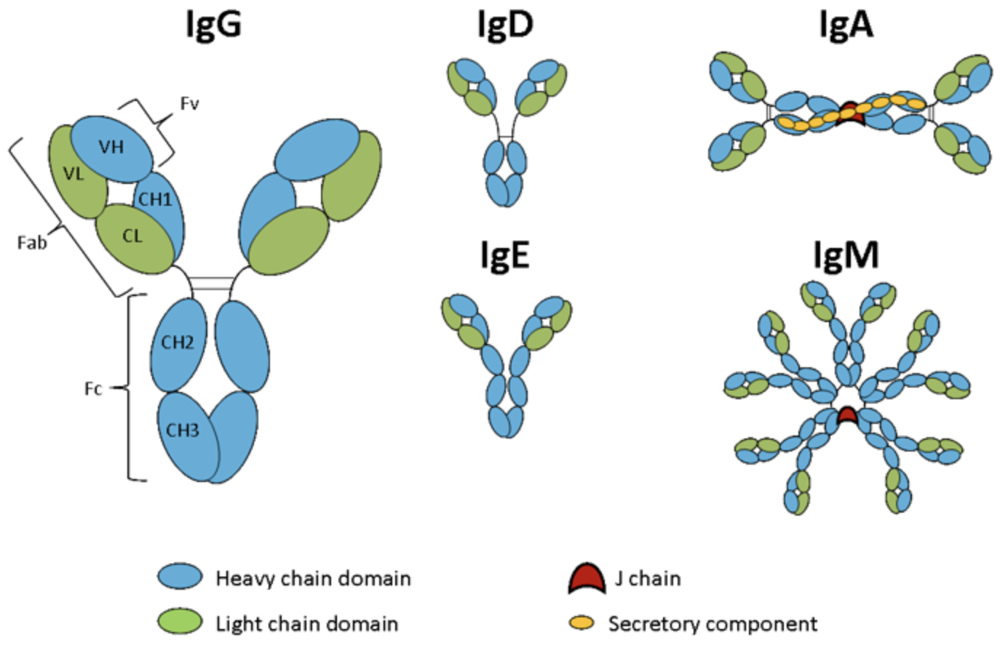
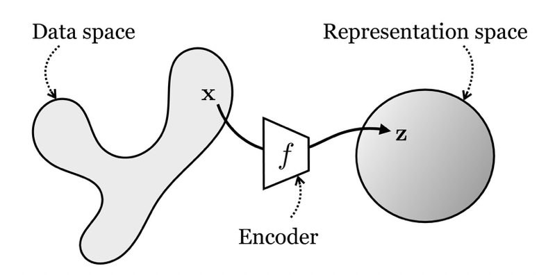

Howdy! My name is Donovan and I am a PhD student at Johns Hopkins University using deep learning and data science principles to push advancements in de novo protein design. Specifically, *I am extremely passionate about antibodies*! My current research is focused on finding unique ways to model antibody genes to better understand their underlying mechanisms (i.e. somatic hypermutation and selection biases). To do so, I typically use language models paired with statistical modeling but, I seldom shy away from using alternative representations to assist with modeling these genes.

Feel free to check out [info about me](about.md), details about [current research](research.md), and my passionate side hobby [teaching tutorials](lwm.md)

**What keeps me up at night:** 
  - **Antibody design**: Can you believe that a single-chain variable fragment (scFv) (~ 225-250 amino acids) has over 2e200 possible combinations. For reference there are up to 4e11 stars in the Milky Way galaxy; so if each star had a galaxy of stars, we would still have LESS stars than possible combinations. Thus, antibody design is like searching for a `needle in a haystack`, given a specific target. Deep learning tools allow us to explore this haystack with a `kitchen magnet`; *although we aren't guaranteed to find the needle, it sure does make the search a lot easier!*

  

Image Source: [Absolute Antibody](https://absoluteantibody.com/antibody-resources/antibody-overview/antibody-isotypes-subtypes/)

  - **Deep Learning Representations**: Historically, scientists have represented proteins using naïve approaches (such as one-hot encodings) or biophysically informed ones (hydrophobicity, charge, aromaticity, etc.). However, deep learning introduces a new representation by just "letting the model figure it out". Is this really better than previous naïve techniques that hundreds of scientists have spent decades using? How well do these learned embeddings generalize to unseen antigens? Do larger embedding dimensions lead to better generalizability? There are so many unanswered questions!

  

Image Source: Chapter 30 in [Foundations of Computer Vision](https://visionbook.mit.edu) by Antonio Torralba, Phillip Isola, and William Freeman

